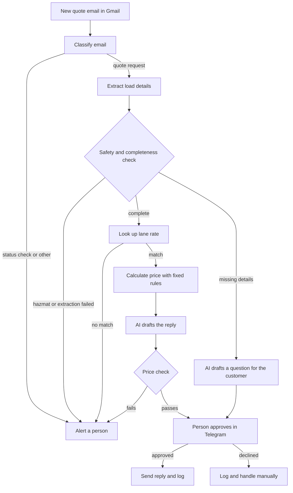

# QuoteFlow for Freight

**Turn a messy quote email into a priced, approved reply in about a minute.**

QuoteFlow is an AI-assisted quote automation built in n8n for freight brokerages. It reads incoming quote requests, calculates the price with fixed business rules, drafts the reply, and waits for a person to approve it before anything is sent.

> **Status:** Working demo built with sample data. It is not connected to any live customer or real rate card.

---

Screenshot of the workflow:

## The business problem

Freight brokerages run on email. A quote request arrives in a shared inbox, and a rep has to:

1. Read it and work out the lane, equipment, weight, and pickup date.
2. Look up a rate and apply the company's margin.
3. Write and send a reply.

While that happens, a faster competitor covers the load. Reps also lose hours every day switching between the inbox, spreadsheets, and rate tools, and small teams cannot afford enterprise software to fix it.

## The solution

QuoteFlow handles the repetitive steps and keeps people in control of the decisions.

| Step | Who does it |
|---|---|
| Read and understand the email | AI |
| Pull out lane, equipment, weight, date | AI |
| Look up the lane rate | Rate table |
| Calculate the price | Fixed rules, no AI |
| Write the reply | AI |
| Check the draft matches the price | Automatic check |
| Approve and send | A person |

**The design rule that matters most:** the AI never does the pricing math. Price comes from plain rules (miles x rate per mile, plus fees, plus margin), so the same load always gets the same price and the AI cannot invent a number.

## Business value

- **Faster replies.** In three demo tests, the time from email arriving to reply sent was 0.7, 0.9, and 1.0 minutes. That includes the human approval tap. Real results will vary with inbox size, email polling, and how quickly a rep approves.
- **Fewer lost loads.** The first company to answer a quote often wins the job.
- **More capacity without more headcount.** Reps spend less time on copy and paste work and more time on carrier relationships and sales.
- **Consistent pricing.** The margin rule lives in one place, so every quote follows it.
- **Trust.** Nothing reaches a customer without a person approving it, and risky requests are never handled automatically.
- **A measurable record.** Every quote is logged with timing and price, which feeds a simple monthly report.

## Built-in safety

| Situation | What the system does |
|---|---|
| Hazmat or dangerous goods | Sent to a person, no quote drafted |
| Lane not in the rate table | Sent to a person, no guess at a rate |
| Missing details (no weight, no date) | Drafts a question for the customer, a person approves it |
| Status check ("Where is my load?") | Not treated as a quote, sent to a person |
| Unknown or off-topic email | Sent to a person |
| Draft price does not match the calculated price | Blocked, sent to a person |
| AI extraction fails | Sent to a person with an alert |
| Any workflow error | Alert message with the failed step |

Hazmat detection also uses plain keyword rules on the raw email, so it still works if the AI fails.

## How it works

**Details extracted from each email:** origin and destination city and state, equipment type, pickup date, weight, commodity, special requirements, hazmat flag, contact name, and anything unclear.

## Business rules you can change

All set in one Code node, with no other edits needed:

| Rule | Demo value |
|---|---|
| Margin on carrier cost | 15% |
| Minimum charge | $350 |
| Flat fees | Liftgate, tarps, team drivers |

## Tech stack

- **n8n** for workflow automation
- **Gmail** for the inbox, replies, and labels
- **Google Gemini** for classification, extraction, and a backup model through OpenRouter or OpenAI
- **Airtable** for the lane rate table and the quote log
- **Telegram** for the human approval step

## Data tables

**Lane Rates**

| Field | Type |
|---|---|
| origin_city, origin_state | Text |
| destination_city, destination_state | Text |
| equipment_type | Text (`dry_van`, `reefer`, `flatbed`) |
| miles | Number |
| rate_per_mile | Number |

**Quote Log**

| Field | Type |
|---|---|
| received time, sent time | Date and time |
| response minutes | Number |
| lane, equipment | Text |
| price | Number |
| status | Single select (Approved, Disapproved) |

## Setup overview

1. Import the workflow JSON from the `workflow` folder into n8n.
2. Connect credentials for Gmail, Airtable, Telegram, and your AI model provider.
3. Create the two Airtable tables above and load your lane rates.
4. Create the Gmail labels `Quote Requests` and `Processed`.
5. Set your margin, minimum charge, and fees in the price calculation node.
6. Create an error workflow with an Error Trigger and a Telegram alert, then link it in the main workflow settings.
7. Test with the sample emails in the `test-emails` folder, then publish.

## Test scenarios included

| Email | Expected result |
|---|---|
| Clean quote request | Priced draft, approval, reply sent |
| Messy request with abbreviations | Extracted correctly, priced draft |
| Missing weight and date | Question drafted for the customer |
| Lane not in the rate table | Alert, no quote |
| Hazmat load | Alert, no quote |
| "Where is my load?" | Alert, not treated as a quote |

## Known limits

- Built for **full truckload** pricing (miles x rate per mile). LTL pricing needs freight class and dimension logic.
- When a customer answers a missing-info question, the reply arrives as a new email and is not yet linked to the original request.
- The built-in n8n approval page shows an n8n footer.
- Email polling adds up to a minute before processing starts.
- Demo data only: the rates and lanes are made up.

## Who this is for

- Small and mid-size freight brokerages and forwarders
- Any business that answers price requests by email, such as cleaning companies, movers, printers, installers, and waste collection services

The same pattern works anywhere the steps are: read a request, look up a price, draft a reply, and have a person confirm.

## Roadmap

- Link customer replies to the original request
- Check-call and tracking updates
- Document parsing for BOLs and rate confirmations
- Monthly report of quotes handled and response times
- LTL pricing support

## Work with me

I build practical AI automations for businesses that want to save time without losing control.

**QueenEagleAI**
Portfolio: https://queeneagleai-plum-iota.vercel.app 

Email Address: queenikwuji@gmail.com 

LinkedIn: www.linkedin.com/in/queen-ikwuji-8b925524a

If quote emails slow your team down, I would like to hear how you handle them today.
